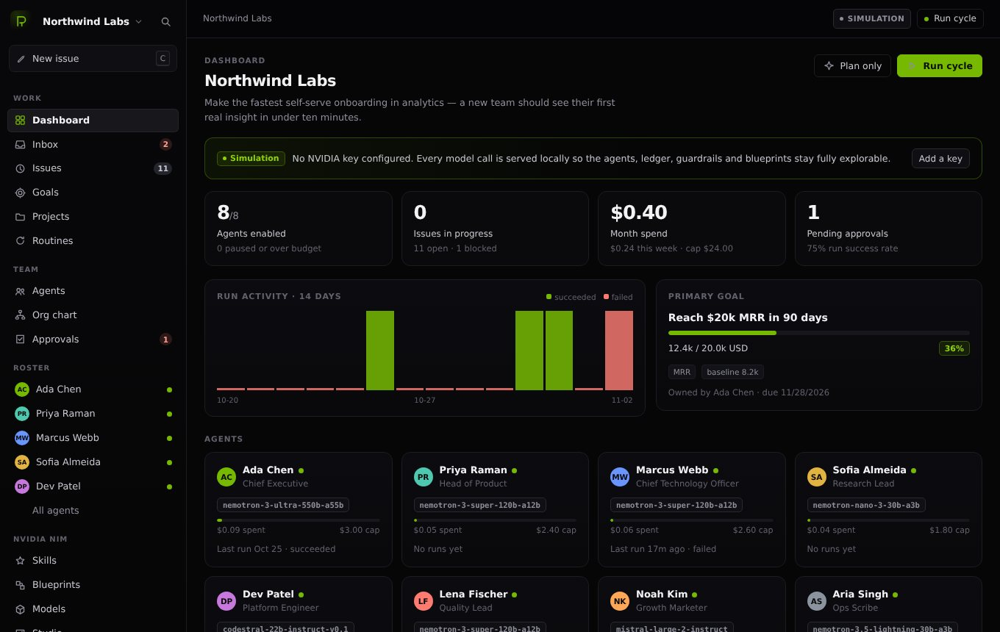
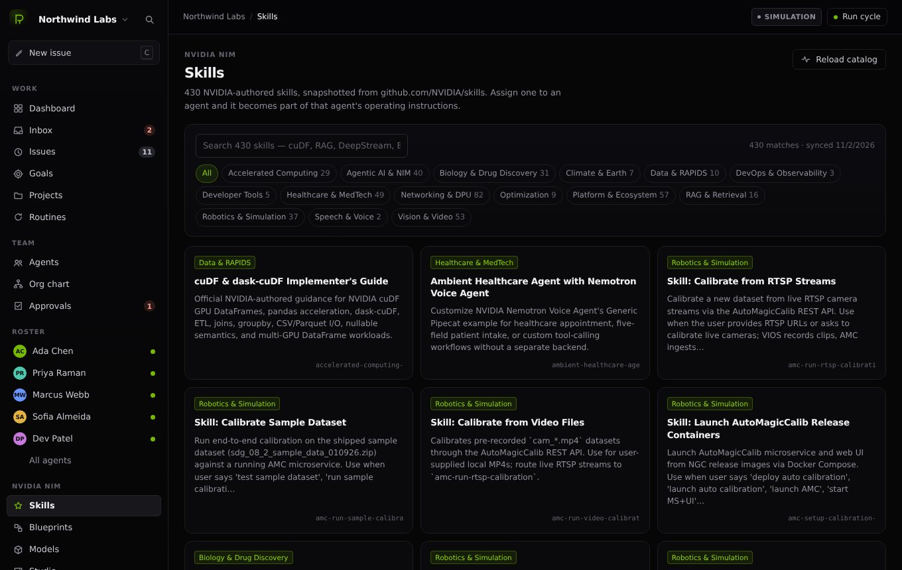
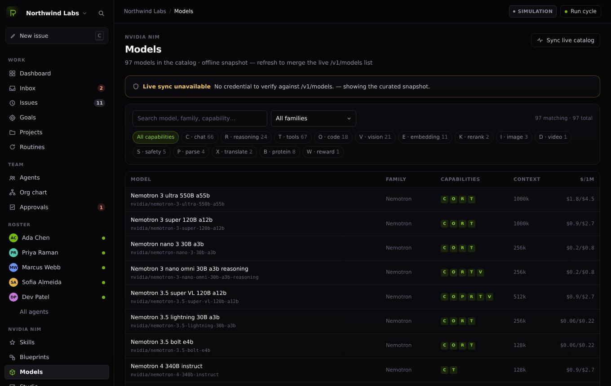
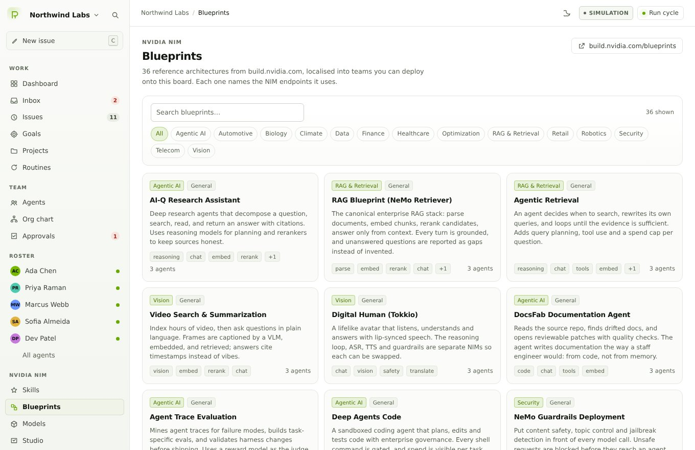
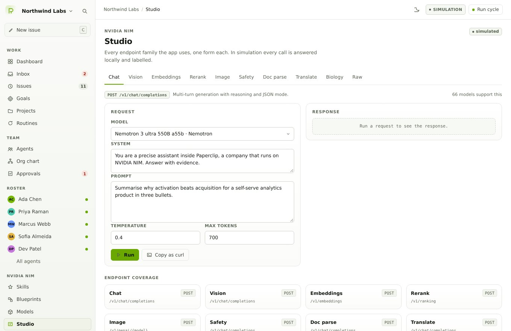

# Paperclip × NVIDIA NIM

A working clone of [Paperclip](https://github.com/paperclipai/paperclip) — the "company of AI agents" control room — rebuilt so that **every agent, skill, blueprint and model call runs on the NVIDIA NIM surface**: the models catalog, the 430-skill library, the 36 reference blueprints, and the raw inference endpoints behind them.

Zero runtime dependencies. One Node process. Data on disk. Runs offline in a deterministic simulation, and switches to real `integrate.api.nvidia.com` inference the moment you add a key.

```
  ✂  Paperclip × NVIDIA NIM
  ├─ listening   http://0.0.0.0:8790
  ├─ mode        SIMULATION  (no key — deterministic simulator)
  ├─ NIM base    https://integrate.api.nvidia.com/v1
  ├─ models      97 in catalog (snapshot)
  └─ data        ./data
```



| | |
| --- | --- |
|  |  |
|  |  |

---

## Quick start

```bash
cd paperclip-nim
npm start            # http://localhost:8790
```

No install step, no build step, no dependencies — Node 20+ is enough.

To run against the real NVIDIA API:

```bash
NVIDIA_API_KEY=nvapi-... npm start
```

…or paste the key into **Settings → NVIDIA NIM connection** (it is verified against `GET /v1/models`, stored in `data/keys.json` with mode `0600`, and never sent back to the browser).

```bash
npm test             # 32 tests: catalog, engine, HTTP surface
npm run sync:skills  # re-snapshot github.com/NVIDIA/skills (optional)
```

---

## What "uses all NVIDIA NIM functions" means here

The app is not a chat box with a NVIDIA badge. Every capability in the NIM API has a screen, a form, a ledger row and an agent that can call it.

| NIM endpoint | What the clone does with it | Where you see it |
| --- | --- | --- |
| `POST /chat/completions` | agent runs, chat, planning, review, guardrails, translation, doc parsing | Agents, Issue detail, Studio, Cycle runner |
| `POST /completions` | legacy text completion | Studio → Raw |
| `POST /embeddings` | knowledge ingestion + retrieval, embedding playground | Knowledge, Studio → Embeddings |
| `POST /ranking` | cross-encoder rerank in front of every context window | Knowledge, Studio → Rerank |
| `POST /genai/{model}` | image artifacts attached to issues | Studio → Image, issue artifacts |
| `POST /biology/{task}` | BioNeMo protein / molecule / genomics tasks | Studio → Biology |
| `GET /models` | catalog, live merge, credential verification, per-model probe | Models, Settings |
| `ANY /v1/{path}` | raw passthrough with typed errors and hints | Studio → Raw |

### Models — 97 in the catalog

The snapshot is built from the real `GET /v1/models` payload plus curated metadata (context window, price per 1M tokens, capabilities, notes), so the UI can filter and route on capability rather than guess from a name:

* current generation — `nvidia/nemotron-3-ultra-550b-a55b`, `nemotron-3-super-120b-a12b`, `nemotron-3-nano-omni-30b-a3b-reasoning`, `nemotron-3.5-lightning-30b-a3b`, `nemotron-3.5-super-vl-120b-a12b`, `nemotron-3.5-embed-8b`, `nemotron-parse-2.0`, `cosmos-reason2-8b`, `riva-translate-4b-instruct-v2`
* NeMo Retriever — `llama-3.2-nv-embedqa-1b-v1`, `nv-embedqa-mistral-7b-v2`, `nv-rerankqa-mistral-4b-v3`, `llama-3.2-nv-rerankqa-1b-v2`, `nvclip`
* NeMo Guardrails — `nemoguard-8b-content-safety`, `-topic-control`, `nemotron-safety-guard-8b-v3`, `llama-guard-4-12b`
* BioNeMo — `bionemo-boltz2`, `evo2-40b`, `esmfold`, `proteinmpnn`, `rfdiffusion`, `diffdock`, `genmol`, `megamolbart`
* multi-vendor — `mistral-large-4-1t-a52b`, `deepseek-v4.1-flash`, `kimi-k2.6`, `minimax-m3.1-flash`, `gemma-4-31b`, `glm-5.3-flash`, `gpt-oss-20b`, `palmyra-*`, `codestral`, and the legacy tail

**Models → Sync live catalog** merges whatever `GET /v1/models` returns for your account: known IDs get `verified` badges, unknown IDs are appended with inferred capabilities so a freshly released NIM shows up without a code change. **Probe** sends one real call and reports latency and a sample.

### Skills — all 430

`data/skills.json` is a snapshot of [github.com/NVIDIA/skills](https://github.com/NVIDIA/skills): 430 `SKILL.md` bundles across 15 categories (Accelerated Computing, Agentic AI & NIM, Biology & Drug Discovery, Data & RAPIDS, …).

A skill is not a badge in this app. Assigning one appends its scope and instructions to the agent's system prompt, and the run trace records which skills were in play — so *"which instructions produced this answer"* is answerable. `GET /api/skills/suggest?q=…` scores the catalog against an issue and proposes the three skills worth attaching.

### Blueprints — all 36 reference architectures

From `build.nvidia.com/blueprints`: AI-Q research assistant, DocsFab, RAG with NeMo Retriever, Deep Agents on Nemotron 3 Ultra, GQE GPU SQL, molecular design with BioNeMo, AI-factory SRE root-cause, self-improving Hermes agents, trading-strategy discovery, and the rest.

Each blueprint ships a team (names, titles, roles, models, budgets), a goal with a real metric, a backlog with acceptance criteria, and a pipeline trace of the NIM functions it needs. **Deploy** turns it into a staffed company with a goal, a board and — optionally — an immediate first cycle.

---

## The product

The Paperclip loop, intact, with NVIDIA as the only model provider:

* **Dashboard** — company health, spend vs cap, the board at a glance, cycle history, recent runs.
* **Inbox** — everything waiting on a human in one list: approvals, blocked issues, failed runs. Approve or deny inline.
* **Issues** — list and board views, priority/assignee/project filters, full issue pages with an editable brief, acceptance criteria, comments, artifacts and a run trace.
* **Run an issue** — `plan → guardrail in → retrieve + rerank knowledge → tools → deliverable → guardrail out → quality review → ledger`. Seven steps, streamed over SSE, with a verdict (`accepted` / `changes_requested`), a numeric score and review findings. A rejected deliverable goes back to `todo` and the next attempt is labelled `Review attempt: 2`.
* **Cycle runner** — the strategist reads goals and the board, returns a plan with focus, assignments and risks, the top issues run inside budget, and a scribe writes the standup from the real results.
* **Agents** — roster tiles, hire modal (role, reporting line, model, remit, capabilities, budget, skills), per-agent profile with 14-day spend, assigned issues, run history, live chat with citations/tools/cost, skills, instructions and runtime knobs.
* **Org chart** — the reporting tree plus roster economics.
* **Goals / Projects / Routines** — metric targets, containers, and scheduled prompts you can run on demand.
* **Spend** — 4 stat cards, a 14-day spend chart, spend by model, the per-agent budget table with inline caps, and the full ledger.
* **Activity** — kind-filtered audit trail with the raw event drawer.
* **Knowledge** — documents embedded with a NIM embedding model, chunked and reranked before every agent context, plus a retrieval playground that shows embed and rerank scores side by side.

Guardrails, budgets and approvals are enforced in the engine, not the UI: a run over cap is blocked with a reason, an output that fails the safety NIM is stopped, and an approval policy of `high` parks risky work in the inbox.

---

## Architecture

```
server/
  index.mjs            HTTP server, static files, graceful shutdown
  routes.mjs           one flat route table; SSE where it matters; error mapping
  runtime.mjs          composition root: store + NIM client + engine + service
  config.mjs           env, data paths, key vault, settings
  store.mjs            JSON documents + NDJSON append, event bus, subscriptions
  domain/
    model.mjs          entity factories, cost/ledger, spend gates, recompute
    seed.mjs           the demo company: 8 agents, 16 issues, goals, knowledge
    retrieval.mjs      chunk → embed → cosine → rerank → prompt context
    tools.mjs          agent tools (knowledge search, issue lookup, ledger, web)
    engine.mjs         plan / runIssue / chat / cycle / routines / approvals
    service.mjs        view models the UI consumes
  nim/
    catalog.mjs        97-model catalog, capabilities, costs, live merge
    client.mjs         one adapter per endpoint family + raw passthrough
    sim.mjs            deterministic simulator (hash-seeded, no network)
    skills.mjs         430-skill catalog + search + suggestions
    blueprints.mjs     36 blueprints → deployable plans
    usage.mjs          AsyncLocalStorage usage context → ledger rows
    intake.mjs         credential parsing (paste a key, env line or curl snippet)
web/
  index.html  styles.css  lib.js (DOM/SSE/format helpers)  app.js (shell, router, palette)
  views/      19 view modules, each `render(root, ctx)` → optional cleanup
data/         companies/*.json, skills.json, settings.json, keys.json(0600)
test/         catalog · engine · api
```

**Simulation is a first-class mode.** With no key, `nim/sim.mjs` answers every endpoint deterministically from the prompt (hash-seeded), so screenshots, tests and demos are reproducible — and every response is labelled `simulated: true` in the UI, the trace and the ledger. Adding a key flips the same code path to real inference; no view changes.

---

## API

Every screen is a thin client over a JSON API. Highlights:

```
GET    /api/health | /api/status | /api/bootstrap
GET    /api/companies                     POST /api/companies
GET    /api/companies/:id/dashboard|inbox|ledger|org|export
POST   /api/companies/:id/cycle[?stream=1]      POST …/plan
GET    /api/companies/:id/agents          POST/PATCH/DELETE
POST   /api/companies/:id/agents/:agentId/chat  (SSE)
PUT    /api/companies/:id/agents/:agentId/skills
GET    /api/companies/:id/issues          POST/PATCH/DELETE
POST   /api/companies/:id/issues/:issueId/run[?stream=1]  (SSE)
POST   /api/companies/:id/issues/:issueId/comments
POST   /api/companies/:id/approvals/:approvalId/decide
GET/POST/PATCH  /api/companies/:id/{goals,projects,routines,knowledge}
POST   /api/companies/:id/knowledge/search
POST   /api/companies/:id/blueprints/:blueprintId        (deploy)
GET    /api/skills | /api/skills/meta | /api/skills/:id | /api/skills/suggest
GET    /api/blueprints | /api/blueprints/:id
GET    /api/models        POST /api/models/refresh | /api/models/probe
POST   /api/studio/{chat,embed,rerank,image,parse,translate,safety,biology,raw}
GET/PATCH /api/settings   GET/POST/PATCH/DELETE /api/keys   POST /api/keys/verify
POST   /api/data/reset | /api/data/prune      GET /api/events (SSE)
```

Full reference: [`docs/API.md`](docs/API.md). Endpoint-by-endpoint NIM notes: [`docs/NIM.md`](docs/NIM.md). Design notes and invariants: [`docs/ARCHITECTURE.md`](docs/ARCHITECTURE.md).

---

## Configuration

| Variable | Default | Purpose |
| --- | --- | --- |
| `NVIDIA_API_KEY` | — | key from build.nvidia.com; absent ⇒ simulation |
| `NIM_BASE_URL` | `https://integrate.api.nvidia.com/v1` | any OpenAI-compatible NIM gateway, including self-hosted |
| `PORT` | `8790` | HTTP port (always binds `0.0.0.0`) |
| `FORCE_SIMULATION` | — | keep simulation even with a key (demos, tests) |
| `NIM_DEFAULT_*` | see `.env.example` | override routing defaults (`CHAT`, `REASONING`, `FAST`, `VISION`, `CODE`, `EMBED`, `RERANK`, `IMAGE`, `SAFETY`, `PARSE`, `TRANSLATE`, `REWARD`) |
| `PAPERCLIP_DATA_DIR` | `./data` | keep state somewhere else (used by the tests) |

There is no account, no telemetry and no cloud dependency: `data/` is the whole database, and `GET /api/companies/:id/export` produces a portable bundle you can re-import.

---

## Front-end invariants

Two rules keep the shell from ever painting an empty page, and `test/ui.test.mjs` enforces both:

* **`[hidden]` must beat author CSS.** `styles.css` declares `[hidden] { display: none !important; }`. The palette, modal and drawer roots all set `display: flex/grid`, which otherwise overrides the user-agent `[hidden]` rule and stacks three dark scrims over the app on first paint — the app looks blank while the JS and API are perfectly healthy.
* **Overlays toggle via the `hidden` property**, never a class, so the rule above always applies.

* **Assets are content-addressed.** The HTML links `/styles.css?v=<hash>` and `/app.js?v=<hash>`, the server stamps the same hash onto every module specifier it serves, and the HTML itself is `no-store`. `Cache-Control: no-cache` alone is only a *request* to revalidate; a proxy or browser that ignores it will happily serve last week's stylesheet, which is how a fixed bug keeps looking broken. Change a file, change the URL — no cache can hold it back.

`index.html` also carries a static boot shell (the ✂ mark, `#boot-status`, `<noscript>`) plus a classic-script `window.__pcFail` fallback on `error` / `unhandledrejection` / an 8s watchdog, and `app.js` sets `window.__pcBooted = true` after the first render. If the module graph ever fails, you get a readable message instead of a blank screen.

---

## Notes and limits

* **Simulation is not inference.** It is deterministic, structured and honest about being simulated — useful for exploring the product and for tests, but it will not surprise you with a better answer.
* **Live mode requires egress** to your NIM base URL. If the sandbox cannot reach `integrate.api.nvidia.com`, the app detects it (`/api/models` refresh fails fast), stays on the snapshot and keeps working.
* **Model metadata drifts.** Prices and context windows are curated; `mergeLive` keeps IDs and capabilities honest, but treat `$/1M` as an estimate.
* **The catalog is a snapshot, not a proxy.** It was built from the real `/v1/models` response; re-run **Sync live catalog** whenever NVIDIA ships something new.

Built to mirror Paperclip's product surface (issues, agents, cycles, approvals, budgets, activity) with NVIDIA NIM as the substrate. Paperclip is MIT licensed; this is an independent clone for the NIM ecosystem.
